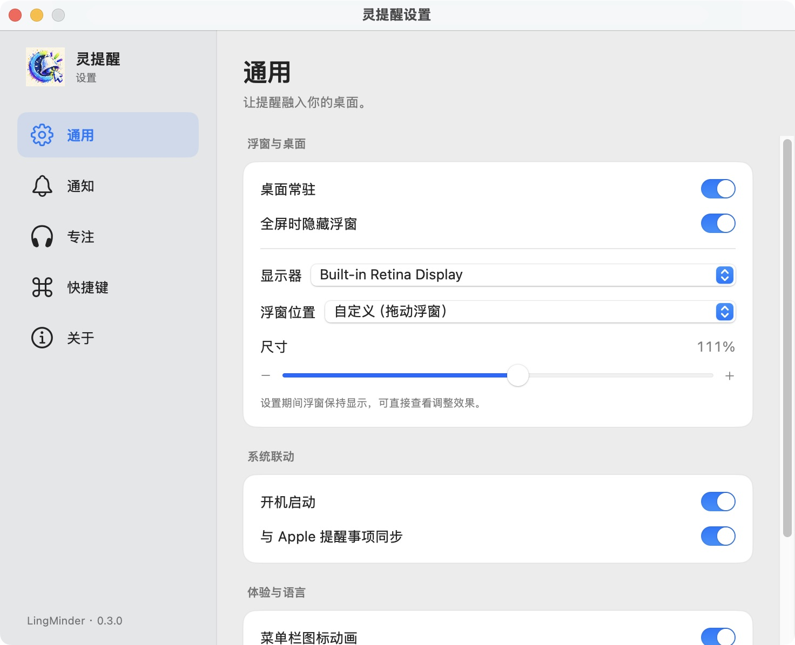

# 灵提醒 · LingMinder 0.3.0

[下载 v0.3.0 应用与完整源码包](https://github.com/674180795-dotcom/LingMinder/releases/tag/v0.3.0) · [验证报告](VERIFICATION.md)




原生 macOS 个人版，功能基准为本机 DeskMinder 2.0.9。界面默认简体中文，通用设置可切换 English。应用使用独立 Bundle ID `local.ling99.LingMinder`，没有导入 DeskMinder 的数据。

## 0.3.0 界面更新

设置采用侧栏导航与分组内容，浮窗使用低染色原生 HUD 材质、细边缘高光；历史与全屏提醒统一字体和间距。设置期间浮窗持续显示，尺寸旁显示实时比例。遵循系统降低透明度、提高对比度及减少动态效果设置。当前构建采用 macOS 15.5 SDK 的原生材质，不包含 macOS 26 的 Liquid Glass API；设计依据与兼容范围见 [DESIGN.md](DESIGN.md)。

## 运行

打开 `build/灵提醒.app`。桌面加号创建提醒：点击后输入分钟或 `HH:mm`，标题可留空，回车提交。鼠标靠近加号时出现紧凑时间条，拖动右侧三条线设置 1–99 分钟；每次新的拖拽从 1 分钟开始，直接输入支持 1–999 分钟。具体时刻表示下一次出现的时刻，因此可以跨午夜。

点击时钟／勾选图标，或用 ↑ ↓ 切换提醒与任务。Tab 在时长和标题间切换，Escape 取消。活动圆环点击打开 +1/+5/+10/+15/+20/+30 分钟竖向菜单，右上角叉号取消；历史中可任意分钟加时和明确完成。系统菜单里的 ⌘N 创建、⌘, 打开设置、⇧⌘H 打开历史，仅在本应用激活时生效；设置里的六组全局快捷键初始未绑定。

浮窗左键按住加号、圆环或空白处移动，位置会保存；编辑时可从空白、上下边缘和操作图标移动，输入框中部保留拖动选字；进入编辑时取得系统键盘焦点，提交与闲置收拢不做位移动画；右键统一打开设置、历史、桌面常驻和退出。闲置时直接隐藏加号，运行圆环保持可见。设置窗口打开期间，浮窗和加号保持可见，尺寸变化即时预览；关闭设置恢复原来的隐藏规则。菜单栏左键唤出浮窗，右键打开菜单。全屏提醒可完成、关闭、稍后 1／5／7／10／15／30 分钟；关闭与 10 秒自动关闭结束该次提醒并进入历史，不提前完成 Apple 提醒事项。

喜欢的持续滴答在「设置 → 专注」启用。滴答、心跳、双耳节拍、放松音乐均在计时运行期间单实例循环，多个项目共享一份背景声音。默认关闭背景音。原版素材已随个人版打包，运行无需原应用。

## 构建与测试

需要 Apple silicon Mac 与 Command Line Tools，脚本固定使用 `/Library/Developer/CommandLineTools/SDKs/MacOSX15.5.sdk`。

```sh
./Scripts/build.sh
./Scripts/test.sh
./Scripts/test-audio.sh
# 播放并监测滴答 10 分钟（自动停止）
./Scripts/audit-ticking.sh
```

构建使用 SwiftUI + AppKit、SQLite、AVFoundation、UserNotifications、EventKit、ServiceManagement 和 Carbon，不依赖第三方包。构建产物是 arm64，目标 macOS 14+；目前真机环境为 macOS 15.8.1。个人构建使用 ad-hoc 签名，更新时退出并替换应用。

音频文件包含在 `Resources/Audio`，逐项 SHA-256 与格式记录在 `Resources/AudioManifest.json`。`Scripts/extract-audio.swift` 可从本机 DeskMinder 2.0.9 重新提取个人使用参考素材；已有资源的构建不再读取原应用。App 图标使用你提供的第二张彩色图；状态栏使用最新提供的透明底图，并按系统深浅色自动显示。

## 数据与系统联动

数据：`~/Library/Application Support/LingMinder/items.sqlite`（SQLite WAL）。设置：应用独立 UserDefaults 域。写入失败会显示错误，读取损坏数据会报告故障，不会自动覆盖数据库。开发测试可通过 `LINGMINDER_DATA` 指定隔离数据目录。

Apple 提醒事项仅在你启用同步并授予系统权限后写入；使用名为「灵提醒」的列表和已保存的 Apple ID，不导入其他新项目。到期只是通知，完成由你操作或已绑定 Apple 条目的完成状态触发。系统同步失败不会移除本地计时，重开且同步启用时再次核对。

开机启动使用系统 `SMAppService`，若系统要求确认请在系统设置的登录项中处理。普通系统通知使用系统授权；未授权且项目到期时，应用会显示全屏提醒并提示权限状态。系统通知横幅受 macOS 限制，10 秒自动关闭控制应用自己的模糊提醒。

## 验收状态

详见 `VERIFICATION.md` 和 `FEATURES.md`。源文件提供了各项功能，未验证的系统权限／外接显示器场景不会标为通过。
